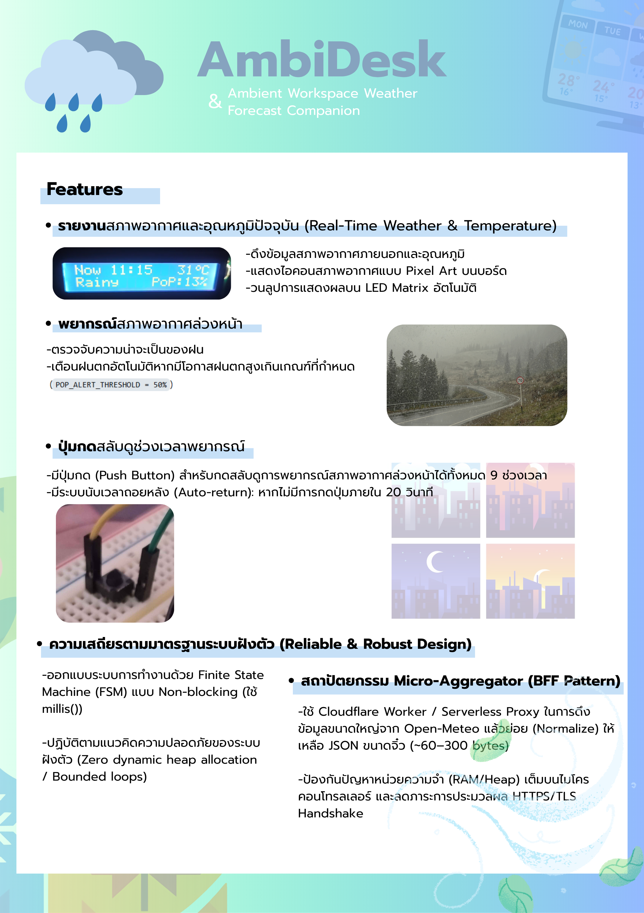

# 🌤️ AmbiDesk - Ambient Workspace Weather & Forecast Companion

**AmbiDesk** คืออุปกรณ์ตั้งโต๊ะอัจฉริยะ (Ambient Computing Companion) ที่ช่วยรายงานสภาพอากาศ อุณหภูมิ และพยากรณ์ความน่าจะเป็นของฝนแบบ Real-time โดยแสดงผลผ่านแผงไฟ **12x8 LED Matrix** ในตัวบอร์ด และจอ **I2C LCD** ช่วยให้ผู้ใช้งานรับรู้สภาพอากาศภายนอกได้ทันทีด้วยการเหลือบมอง (Glanceable) โดยไม่ต้องสลับหน้าจอคอมพิวเตอร์หรือหยิบสมาร์ทโฟนขึ้นมาดูให้เสียสมาธิขณะทำงานหรือเล่นเกม

🌐 **เว็บไซต์จำลองการทำงาน (Live Demo & Source Viewer):** [https://slightlyoffset.github.io/AmbiDesk/](https://slightlyoffset.github.io/AmbiDesk/)

---

## ความสามารถของโปรเจกต์ (Features)

1. **รายงานสภาพอากาศและอุณหภูมิปัจจุบัน (Real-Time Weather & Temperature):**
   - ดึงข้อมูลสภาพอากาศภายนอกและอุณหภูมิ (°C) อัตโนมัติทุกๆ 10 นาที (`POLL_INTERVAL_MS = 600000UL`) ผ่าน Wi-Fi
   - แสดงไอคอนสภาพอากาศแบบ Pixel Art บนบอร์ด LED Matrix เช่น แดดออก (Sun), มีเมฆ (Cloud), ฝนตก (Rain), ฟ้าผ่า/พายุ (Thunderstorm) รวมถึงตัวเลขอุณหภูมิ (°C), เปอร์เซ็นต์โอกาสเกิดฝนตก (%) และไอคอนสถานะระบบ (Boot / Error)
   - วนลูปการแสดงผลบน LED Matrix อัตโนมัติ: ไอคอนสภาพอากาศ (3 วินาที) &rarr; อุณหภูมิ (2 วินาที) &rarr; แจ้งเตือนโอกาสฝนตก (3 วินาที เฉพาะเมื่อมีโอกาสเกิดฝนตกในชั่วโมงถัดไป PoP > 50%)
2. **พยากรณ์สภาพอากาศล่วงหน้า (Precipitation & Timeline Outlook):**
   - ตรวจจับความน่าจะเป็นของฝน (Probability of Precipitation - PoP) ในชั่วโมงถัดไป
   - เตือนฝนตกอัตโนมัติหากมีโอกาสฝนตกสูงเกินเกณฑ์ที่กำหนด (`POP_ALERT_THRESHOLD = 50%`)
3. **ปุ่มกดสลับดูช่วงเวลาพยากรณ์ (Interactive Timeline Inspection):**
   - มีปุ่มกด (Push Button) สำหรับกดสลับดูการพยากรณ์สภาพอากาศล่วงหน้าได้ทั้งหมด 9 ช่วงเวลา (9 Timeline Slots) ได้แก่ `Now`, `+1h`, `+3h`, `+5h`, `+12h`, `+1d`, `+2d`, `+3d`, และ `+4d`
   - มีระบบนับเวลาถอยหลัง (Auto-return): หากไม่มีการกดปุ่มภายใน 20 วินาที (`USER_INSPECT_TIMEOUT_MS = 20000UL`) ระบบจะสลับกลับมาหน้าปัจจุบัน (`Now`) อัตโนมัติ
4. **สถาปัตยกรรม Micro-Aggregator (BFF Pattern):**
   - ใช้ Cloudflare Worker / Serverless Proxy ในการดึงข้อมูลขนาดใหญ่จาก Open-Meteo แล้วย่อย (Normalize) ให้เหลือ JSON ขนาดจิ๋ว (~60–300 bytes)
   - ป้องกันปัญหาหน่วยความจำ (RAM/Heap) เต็มบนไมโครคอนโทรลเลอร์ และลดภาระการประมวลผล HTTPS/TLS Handshake
5. **ความเสถียรตามมาตรฐานระบบฝังตัว (Reliable & Robust Design):**
   - ออกแบบระบบการทำงานด้วย Finite State Machine (FSM) แบบ Non-blocking (ใช้ `millis()`)
   - ปฏิบัติตามแนวคิดความปลอดภัยของระบบฝังตัว (Zero dynamic heap allocation / Bounded loops)

---

## อุปกรณ์ที่ใช้ในโครงงาน (Hardware Components)

| รายการอุปกรณ์ | รายละเอียด / หน้าที่ |
| :--- | :--- |
| **1. บอร์ด Arduino UNO R4 WiFi** | ไมโครคอนโทรลเลอร์หลัก (Renesas RA4M1 + ESP32-S3) พร้อมโมดูล Wi-Fi และแผงไฟ 12x8 LED Matrix ในตัว |
| **2. เบรดบอร์ด (Breadboard)** | แผงต่อวงจรสำหรับเชื่อมต่อปุ่มกดและสายสัญญาณ |
| **3. ปุ่มกด (Push Button)** | สวิตช์ปุ่มกดสำหรับกดเปลี่ยนโหมด/ดูพยากรณ์อากาศล่วงหน้า (เชื่อมต่อขา D2) |
| **4. สายจัมเปอร์ (Jumper Wires)** | สายไฟสำหรับเชื่อมต่อระหว่าง Arduino, Breadboard, ปุ่มกด และหน้าจอ LCD |
| **5. จอ LCD 1602 / 2004 พร้อมโมดูล I2C** | หน้าจอแสดงผลข้อความสถานะ อุณหภูมิ และคำอธิบายสภาพอากาศแบบละเอียด |

---

## แผนผังการต่อวงจรเบื้องต้น (Wiring Diagram)

### 1. ปุ่มกด (Push Button)
* **ขาข้างหนึ่งของปุ่ม:** ต่อเข้าขา **D2** ของ Arduino
* **ขาอีกข้างของปุ่ม:** ต่อเข้าขา **GND** ของ Arduino
> *(หมายเหตุ: โค้ดเปิดใช้งาน Internal Pull-up Resistor (`INPUT_PULLUP`) บนขา D2 ไว้แล้ว ไม่จำเป็นต้องต่อตัวต้านทานภายนอกเพิ่มเติม)*

### 2. จอ LCD (I2C)
* **GND:** ต่อเข้า **GND**
* **VCC:** ต่อเข้า **5V**
* **SDA:** ต่อเข้าขา **SDA** (หรือ A4)
* **SCL:** ต่อเข้าขา **SCL** (หรือ A5)
> *(หมายเหตุ: โค้ดตั้งค่าเริ่มต้น `LCD_I2C_ADDR` ไว้ที่ `0x27` ใน `include/Config.h` หากหน้าจอใช้ชิปคนละรุ่น เช่น PCF8574AT สามารถเปลี่ยนเป็น `0x3F` ได้)*

---

## ไลบรารีที่ใช้งาน (Dependencies)

ไลบรารีภายนอกที่โปรเจกต์ใช้งาน โดย PlatformIO จะดาวน์โหลดและติดตั้งให้อัตโนมัติ (ระบุไว้ใน `platformio.ini`):
- **`bblanchon/ArduinoJson@^7.0.0`**: ใช้สำหรับ Deserialization แปลงข้อมูล JSON จาก Micro-Aggregator
- **`marcoschwartz/LiquidCrystal_I2C@^1.1.4`**: ใช้ควบคุมการแสดงผลข้อความบนจอ LCD ผ่านบัส I2C

---

## การติดตั้งและใช้งาน (Getting Started)

### 1. ฝั่ง Cloud Micro-Aggregator (Backend)
สามารถเลือกติดตั้งและรันได้ 2 วิธี (อ่านรายละเอียดเพิ่มเติมได้ที่ [worker/README.md](worker/README.md)):
- **วิธีที่ 1: Deploy ขึ้น Cloudflare Worker (แนะนำสำหรับการใช้งานจริง)**
  ```bash
  cd worker
  npm install
  npx wrangler deploy
  ```
- **วิธีที่ 2: รันเซิร์ฟเวอร์จำลองบนเครื่องคอมพิวเตอร์ (Local Mock Server สำหรับทดสอบ)**
  ```bash
  cd worker
  npm install
  node dev-server.js
  ```

### 2. ฝั่งฮาร์ดแวร์และเฟิร์มแวร์ (Arduino Firmware)
1. **เตรียมโปรแกรม:**
   - ใช้งานผ่าน [PlatformIO](https://platformio.org/) (บน VS Code)
2. **ตั้งค่า Wi-Fi และเซิร์ฟเวอร์:**
   - คัดลอกไฟล์ `include/secrets.example.h` เป็น `include/secrets.h`
   - แก้ไขค่าคอนฟิกต่าง ๆ ให้ตรงกับการใช้งาน:
     - `WIFI_SSID`: ชื่อ Wi-Fi
     - `WIFI_PASSWORD`: รหัสผ่าน Wi-Fi
     - `AGGREGATOR_HOST`: ใส่เฉพาะชื่อโดเมน (เช่น `"ambidesk-aggregator.workers.dev"`) หรือ IP เครื่องคอมพิวเตอร์ (เช่น `"192.168.1.100"`) **โดยไม่ต้องใส่ `https://` หรือ `http://` นำหน้า**
     - `AGGREGATOR_PORT`: พอร์ตสำหรับเชื่อมต่อ (ค่าเริ่มต้น `443` สำหรับ HTTPS หรือ `3000` สำหรับ Local Dev Server)
     - `AGGREGATOR_PATH`: Path ของ API (ค่าเริ่มต้น `"/"`)
     - `AGGREGATOR_USE_SSL`: ตั้งเป็น `true` เมื่อใช้ HTTPS (Cloudflare Worker) หรือ `false` เมื่อใช้ HTTP ธรรมดา (Local Server)
3. **Build & Upload:**
   - เชื่อมต่อสาย USB ระหว่าง Arduino UNO R4 WiFi กับเครื่องคอมพิวเตอร์
   - กดปุ่ม **Upload** บน PlatformIO
   - เปิด **Serial Monitor** ที่ Baud rate `115200` เพื่อดูสถานะการเชื่อมต่อ

---

## 👥 สมาชิกกลุ่ม (Group Members)

| ลำดับ | รหัสนักศึกษา | ชื่อ - นามสกุล | บทบาท / หน้าที่รับผิดชอบ |
| :---: | :---: | :---: | :---: |
| 1 | 68070003 | กฤตภาส ไพรสาลี | ออกแบบโปสเตอร์ (A1 Poster) |
| 2 | 68070024 | ชนาธิป วาฑิตศุภผล | พัฒนาเว็บไซต์ (Website) |
| 3 | 68070035 | ฐิติวัฒน์ มนต์วิเศษ | ระบบหลังบ้านและเฟิร์มแวร์ (Back-end & Firmware) |
| 4 | 68070083 | นัธทวัฒน์ พละเดช | ระบบหลังบ้านและเฟิร์มแวร์ (Back-end & Firmware) |

---

# Project Poster

---

